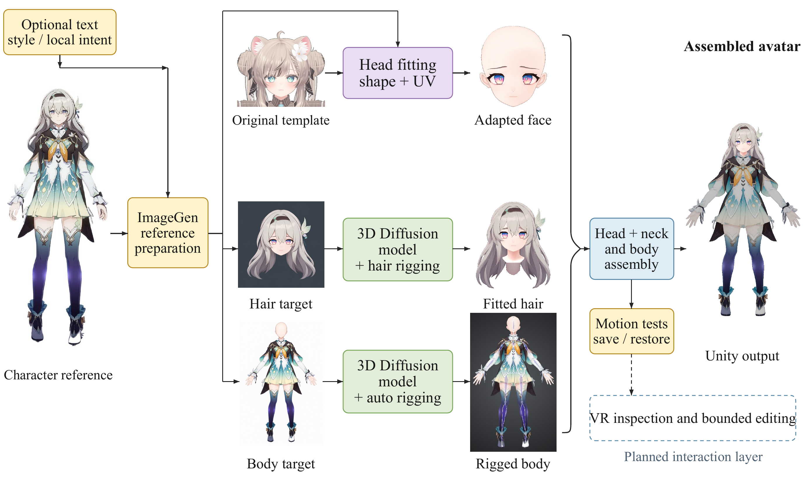

# Anime Avatar Personalization

一个可供 agent 复用的角色定制 skill：**参考图/可选文字 → 模板头部的形状与 UV 定制 → 头发和身体生成 → 头发绑定与物理 → 完整头颈装配 → 动作测试与 Unity 输出**。

**使用前提：给 agent 提供一个可用的二次元风格 VRChat Avatar，最好是头部贴近目标的。** 同时提供目标角色参考和本次要实现的外观/动画要求。需要可编辑的模型及相关控制器；skill 不附带商业 Avatar、生成模型或账号凭据，也不限定某个 Avatar 品牌。

## Method overview



**图中的 “3D Diffusion model” 在我们的测试中使用的是 Tripo。** 图示用于说明流程，不要求其他实现采用相同的生成服务。头发骨链、蒙皮权重、物理与最终装配仍需单独适配和验证。

图中模板和角色仅作方法示意。实际使用时换成用户提供的 Avatar 与目标角色；保留模板的眼球、眼睑、口腔及面部控制，定制脸型/五官/贴图，分别生成头发和穿衣身体，最后以完整头部和颈部装配。底部虚线框 **“VR inspection and bounded editing” 是规划中的交互层**，不属于本 skill 已提供的软件功能。

## 使用

Skill 位于 [`skills/anime-avatar-personalization`](skills/anime-avatar-personalization/SKILL.md)，入口是 `SKILL.md`，包含按任务加载的脸部、头发、身体装配和验证指南，以及一份角色执行工作表。该目录可独立安装，不依赖本仓库外的历史工程或实验报告。

向支持 GitHub skill 安装的 agent 提供本仓库地址和目录 `skills/anime-avatar-personalization`；也可把该完整目录复制到本机 Codex 的 skills 目录。安装后按客户端要求刷新技能发现，再调用：

```text
请从 https://github.com/wuxiaoxi75-dot/anime-avatar-personalization/tree/main/skills/anime-avatar-personalization
安装 anime-avatar-personalization skill。
```

```text
使用 $anime-avatar-personalization。
我提供一个可编辑、可用的二次元 VRChat Avatar 和目标角色图。
请保留头部与颈部的面部动画能力，完成脸部、头发及身体定制，
展示行走、蹲起、眼珠移动、眨眼和口型的组合动画，并报告未完成项。
```

需要的工具由任务决定：ImageGen 或用户提供的目标图、三维生成服务（测试中使用 Tripo）、Blender、Unity 与兼容的 VRChat SDK/shader。需单独准备相应工具和资产的可用访问；本仓库不包含它们的安装包、模型权重或订阅。

## 提供什么

- 模板头颈的动画能力保护、脸型与 UV 适配、独立眼珠/眉睫处理。
- ImageGen 睫毛图案、眼孔注册、正常/笑眼多关键形态、局部拖尾闭合策略。
- 头发生成与四面筛选、逻辑发束、骨链、代理权重、真实物理 off/on 对照。
- 身体生成接口、衣领保护、完整头颈移植、骨架和静止姿态核验。
- 原生连续动画、保存重开、缺陷分级与平台验收工作流。

这是**指导 agent 实施和验证的方法 skill**，不含已实现的通用三维生成/自动绑定程序，不保证任意输入一键成功。生成后的裙装、头发碰撞、眼睑接触与 SDK 自动输入都需要按角色检验，未通过项应明确记录。

## 内容范围

仓库仅包含通用 skill 文本、执行工作表、UI 元数据和用户提供的流程示意图。无历史实验报告、日志、模型、输出视频、私有工程、机器配置或凭据。

示意图包含角色与模板外观展示，供流程说明；本仓库不授予其中角色、Avatar、模型或素材的使用权。实际项目需使用自己有权使用的资产。
